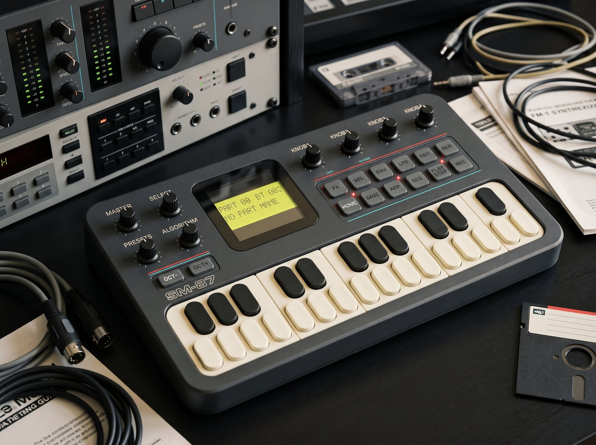

# SM-87

*SM-87 as a 1987 studio might have had it: an illustration, made with an image generator. The FM-1 itself looks
different.*

A firmware for the M-VAVE FM-1 that recreates a 1986/87 studio: an **Alesis MMT-8** style part/song sequencer
driving an **Akai S700 / X7000** style sampler and an **Alesis HR-16** style drum machine. It is built on
[fm1-base](https://github.com/charlesvestal/fm1-base) (MPL-2.0, a git submodule here) and felucca-bsp.

**Status: works in fm1-base's host simulator and browser emulator, and builds for the FM-1. It hasn't run on an FM-1
yet** (see *On the device*).

- **[The site](https://rogerkl.github.io/sm-87/)**: the [installer](https://rogerkl.github.io/sm-87/install/) (Chrome or
  Edge, the FM-1 by USB), the [emulator](https://rogerkl.github.io/sm-87/emu/) and the
  [manual](https://rogerkl.github.io/sm-87/manual/) ([app/docs/MANUAL.md](app/docs/MANUAL.md) here).
- **[Releases](https://github.com/rogerkl/sm-87/releases)**: the firmware packages, built and signed on GitHub.

## What it does

- **The sequencer** works like the MMT-8: 100 parts of 8 tracks and 100 songs, real-time recording that replaces a
  track like tape, track mutes per song step, MIDI clock in and out, the MMT-8's functions (ERASE, COPY, MERGE,
  QUANTIZE, TRANSPOSE, EDIT...) and its memory dump both ways.
- **The sampler** plays samples the way an S700/X7000 does, with its filter, level, release and vibrato as measured
  on an X7000, in 32 programs of key ranges and the S700's MIDI modes. It answers over USB as an X7000 with 16 slots,
  so [Axs7](https://rogerkl.github.io/Axs7/) sends and fetches its samples.
- **The drum machine** is a cut-down HR-16: 16 pads, 100 patterns recorded as they loop with quantize and swing, a
  pattern's own sounds, and the HR-16's memory dump both ways. It plays with the sequencer on one clock.
- **The screen** is a 2 × 16 character LCD, drawn dot by dot, with a status strip under it.

**The manual**, [app/docs/MANUAL.md](app/docs/MANUAL.md) (also on the [site](https://rogerkl.github.io/sm-87/manual/)),
has the controls, the pages and the MIDI. The site has the [installer](https://rogerkl.github.io/sm-87/install/) and
the [emulator](https://rogerkl.github.io/sm-87/emu/).

SM-87 is MPL-2.0 ([LICENSING.md](LICENSING.md)).

## Layout

| | |
|---|---|
| `app/` | The firmware: `app.c` (glue, routing, render, pages), `fm1.toml`, `app.h` (contract, flash map) |
| `app/s700/` | The sampler: `s7engine.c` (voices), `s7mem.c` (flash pool, directory), `s7bank.c` (the samples built in), `sds.c` (sample dump, SPRM, OVS) |
| `app/mmt8/` | The sequencer: `seq.c` (memory, takes, edits), `player.c` (clock, MIDI clock in, playback, recording, songs), `mmtdump.c` (the MMT-8's SysEx dump) |
| `app/hr16/` | The drum machine: `hrkit.c` (the kit, the pads, a pattern's own sounds, their voices), `hrpat.c` (patterns, their player, recording), `hrdump.c` (the HR-16's SysEx dump) |
| `app/ui/` | The LCD (`lcd.c`, a 5 × 7 font) and the pages; `seq_edit.c` the MMT-8's functions, `pages_drum.c` the HR-16's page |
| `app/tests/` | Scripts for the host simulator (`sysex.txt` is generated by `test/gen_sysex_test.py`; `screens.txt` makes the manual's pictures) |
| `app/docs/` | The manual, `MANUAL.md`, and its pictures (`img/`; `screen.png` is the firmware's card on firmware hubs) |
| `app/site/` | The site's front page, `landing.md` (fm1-base's `tools/make_site.py` makes the site) |
| `test/` | C unit tests against the X7000 measurements, Axs7's fixtures and the MMT-8's behaviour; `run.sh` runs all |
| `tools/mkrom.py` | Samples built in, from WAV files and `.qd` images: put into a firmware package, or `app/rom/emu_bank.h` for the host simulator and emulator (not in the repository) |
| `web/sm87bank.js` | Samples put into a firmware package in the browser: `mkrom.py`'s packaging in JavaScript, with no imports, for a page to copy (`sm87bank.d.ts` its types) |
| `resources/kit/` | The drum kit: its WAV files and `kit.txt`, the list of its sounds and its pads' set-up |
| `tools/mkkit.py` | The drum kit made a header as the firmware is built (`fm1.toml` `gen`), or a report of it |
| `documentation/` | The S700/X7000 reference, the HR-16's dump, the sample bank's format, and `manuals.md`: the machines' manuals, which aren't in the repository |
| `build.sh` | The build: fm1-base's `tools/build.py` on `app/`, its options passed on |
| `.github/workflows/` | `tests.yml` (the tests on every push), `release.yml` (a release, from a tag) |
| `patches/` | fm1-base's changes for the browser emulator's SysEx, until they are in fm1-base |
| `LICENSE`, `LICENSING.md` | MPL-2.0, and what else a firmware package holds |

### Flash

| Range | Use |
|---|---|
| Below 0x93000 | The firmware's slot (581,564 bytes): the firmware with the drum kit, then the samples built in at its top |
| 0x93000-0xDC000 | Sample pool (73 sectors of 4 KB), packed 12-bit |
| 0xDC000, 0xDE000 | Store objects: settings; sample directory and parameters (A/B pairs) |
| 0xE0000-0xE5000 | The update loader's staging (not the app's) |
| 0xE5000-0xFC000 | Sequencer memory, the drum patterns too (3,840 bytes a sector: the update loader's bytes at 0xF00 kept erased) |
| 0xFC000 | Store object: the panel calibration (fm1-base's) |

## Building and testing

You need fm1-base's Python tools: Pillow, numpy and mido, in a venv in `.venv` (`build.sh` and `test/run.sh` use it)
or the Python that `PYTHON` names. The tests also use Axs7's test fixtures (a real X7000's dumps and disk images):
clone [Axs7](https://github.com/rogerkl/Axs7) beside this repository as `../Axs7SdsW`, or set `AXS7` to it.

    git submodule update --init --recursive
    test/run.sh                                   # unit tests, then the host simulator's scripts
    ./build.sh --host
    app/build/host/sm87_host app/tests/seq.txt app/build/host    # screenshots land there too
    app/build/host/sm87_host app/tests/screens.txt app/docs/img  # the manual's pictures, and the hub's screen.png

GitHub runs `test/run.sh` on every push and pull request (`.github/workflows/tests.yml`), with Axs7's fixtures at a
fixed commit.

### Samples built in

`tools/mkrom.py` puts samples into a firmware package (`.fwsc`), as its slots' factory contents. That gives you
something to play without a sampler or computer sending any, and more sample memory than the pool alone. It needs no
compiler or JieLi SDK: it opens the package as it is, a release's or your own build's, writes the samples above the
firmware in its slot, and makes the package's checksums again (`documentation/sample-bank.md`).
- It takes WAV files. Axs7's carry their settings and keygroups in an `axs7` chunk, which are taken as they are;
  other WAVs give their `smpl` loop and root key, and are resampled to the nearest of the sampler's rates.
- It takes S700/X7000 `.qd` disk images, with all their parameters and programs.
- It changes the package in place, or writes another with `-o`. Run again, it replaces the samples; `--none` takes
  them out and gives the package back as it was built, byte for byte. With the package alone, it says what's in it
  and how much room there is.
- A dump sent to a slot replaces its built-in sample, and CLEAR (EDIT) empties the slot.

    W=../Axs7SdsW/sounds/wav
    .venv/bin/python tools/mkrom.py sm87.fwsc $W/85_grand_piano_e1.wav $W/86_grand_piano_c2.wav \
        $W/87_grand_piano_a2.wav $W/88_grand_piano_f3.wav $W/89_grand_piano_d4.wav $W/90_double_bass.wav \
        "some disk.qd@16"
    python3 fm1-base/tools/fm1_install.py sm87.fwsc

That example is a piano split over 5 samples, the double bass on keys 36-52 in program 1, and a disk in slot 16.
Don't take the disk images in Axs7's `web/test/fixtures` for one: their audio is a test ramp through every 12-bit
value, a buzz that follows the pitch. `mkrom.py` refuses more than the slot has room for.

A drum kit can go in too, replacing the one the firmware was built with: `--kit` takes a list in
`resources/kit/kit.txt`'s form (*The drum kit*), its WAV files beside it. Up to 64 sounds and 16 pads. Its sounds
are the drum machine's own and take no sampler slot. Without `--kit` the firmware's own kit plays: each run puts in
the whole, samples and kit as it is told.

    .venv/bin/python tools/mkrom.py sm87.fwsc piano.wav@1 --kit ../my-kit/kit.txt

The samples and kit are in that package only: a new firmware comes without them, so put them into its package too.
The firmware checks them at boot (their CRC), and plays none from a damaged package. When the kit changes, the pads
take its set-up (the settings keep which kit they were saved with); a pattern's own sounds keep the kit's sounds by
number.

Axs7 does it in the browser: INIT SM-87 BANKS (its BANK page) makes a SAMPLES bank and a DRUMS bank of the HR-16's
16 drums, which PROGRAM then edits as drums (one keygroup each, tuned in semitones, a pan). It puts both into a
package you open, with a meter of the room they take, and saves it or installs it on the FM-1 over USB (fm1-base's
installer, as its web page runs it). TAKE ITS SAMPLES brings a package's samples and kit back into the two banks, to
put them into a new release's package. It uses `web/sm87bank.js`, which does the same as `mkrom.py`
for a page that makes the samples itself: `makeBank` makes the bytes of the samples and a kit, `Sm87Package` opens a
package, says what it holds and its room, takes them (`put`) and gives the package back (`bytes`). For a kit of the
HR-16's 16 drums, `HR16_DRUMS` says which pad each goes on (where an HR-16 dump puts it) with its name and note, and
`hr16Pads` makes the pads. It gives `mkrom.py`'s bytes (`test/bank_js_test.mjs`); Axs7 keeps a copy, and its tests
check the copy is this one.

The host simulator and the browser emulator have no firmware slot. For them, `mkrom.py --emu FILE ... [--kit KIT]`
writes `app/rom/emu_bank.h` (not in the repository: the sounds aren't ours to publish), built in while it exists;
`--emu --none` removes it. `test/run.sh` sets it aside while it runs and puts it back.

#### Getting the most samples in

The FM-1 keeps samples in two places, and a full set uses both:

| | Room | Filled by | Kept |
|---|---|---|---|
| Built in, in the firmware's slot | 372 KB, beside the firmware (159 KB) and the drum kit (37 KB) | `mkrom.py`, then installing the package | Each to the byte, plus 188 bytes for its settings. Until another firmware is installed |
| The sample pool | 292 KB (FREE on the sampler's strip) | Sample dumps over USB at any time: Axs7, or an X7000 through it | In whole 4 KB sectors. Saved by themselves 3 s after the transfer |

That's about 664 KB in all, 13 full-length samples of 48 KB, in the sampler's 16 slots, which the two share. A dump
to a slot with a built-in sample takes pool space and leaves the built-in one unused until the next install.

- **Short sounds built in.** The pool rounds each sample up to whole sectors, so a 1 KB hit takes 4 KB there.
  Built in, it takes 1 KB.
- **The rate to suit the sound.** A sample takes 1.5 bytes a word at any rate, and has at most 32,752 words. So the
  lower the rate, the longer it plays: 0.83 s at the top rate (39.6 kHz), 1.5 s at 22.2 kHz, 2.1 s at 15.7 kHz,
  4.2 s at 7.8 kHz. A bass or a pad loses little at a low rate, as on the S700. `mkrom.py` uses the nearest of the
  sampler's 41 rates to the WAV's own, so resample a WAV first (in Axs7, or any editor) to make it smaller.
- **Trimmed and looped.** `mkrom.py` keeps a WAV from its first word to END, and a looped one to its loop end. Cut
  silence off the start first, and loop a sound that holds instead of keeping all of it.
- **One sample over many keys.** With short sounds the 16 slots run out before the memory does. One sample can play
  over a whole key range, and in several programs with a transpose each, as the S700's keygroups do. Axs7 sets them
  and saves them in its WAV files, which `mkrom.py` takes as they are.
- **The kit shares the slot.** The drum kit (`resources/kit`) takes 37 KB of the same room. Fewer, shorter or
  lower-rate kit sounds leave more for samples (that one takes a build), and a drum pad can play a sampler slot too
  (PAD SOUND).
- **The room is the package's.** `mkrom.py PACKAGE.fwsc` says how much the firmware in it leaves. A later firmware
  may leave a little less.

The steps:

    .venv/bin/python tools/mkrom.py sm87.fwsc                                     # the room
    .venv/bin/python tools/mkrom.py sm87.fwsc bass.wav@1 strings.wav@2 "a disk.qd@3"
    python3 fm1-base/tools/fm1_install.py sm87.fwsc

Then send the rest to the pool from Axs7 over USB, as to an X7000 (*In the browser* says how it finds SM-87).

### The drum kit

The drum machine's sounds are in `resources/kit`: the WAV files, and `kit.txt`, the list of them.
- `sound` lines name a WAV file in the folder.
- `pad` lines set up the pads in order: a sound, tuning, level, pan, note, group and voices.

Every build makes the kit into a header of its own (`fm1.toml`'s `gen` runs `tools/mkkit.py`), so a change to the
folder is in the next build. Run by hand, `mkkit.py` reports what the kit holds and takes:

    .venv/bin/python tools/mkkit.py

The kit's sounds (37 KB now) are part of the firmware's image, so they take from the room `tools/mkrom.py` has for
samples in the slot (568 KB in all). It is the minimal kit every build has. Another kit, of up to 64 sounds and all
16 pads, goes into a package without a build: `tools/mkrom.py --kit` takes a list of this form (*Samples built in*).

The kit is designed to grow:
- A pad keeps its sound by number, so add new sounds at the end of the list.
- A pad saved with a sampler slot keeps it when the kit grows.

### In the browser (fm1-base's emulator, with SysEx both ways)

The same app compiled to WebAssembly. Its MIDI part gives it Web MIDI in and out, SysEx included; its data part
keeps the flash, so the samples, in the browser. It needs Emscripten:

    git clone https://github.com/emscripten-core/emsdk ~/emsdk && ~/emsdk/emsdk install 6.0.10 && ~/emsdk/emsdk activate 6.0.10
    source ~/emsdk/emsdk_env.sh
    cd fm1-base && ../.venv/bin/python tools/build.py ../app --web     # app/build/emu/
    python3 -m http.server -d ../app/build/emu 8087                     # open http://localhost:8087 in Chrome or Edge

To talk to Axs7, make two virtual MIDI cables, e.g. "to SM87" and "from SM87" with loopMIDI on Windows. Then:
- **Emulator:** MIDI ports, input "to SM87", output "from SM87".
- **Axs7:** output "to SM87", input "from SM87".

Axs7 finds it as it finds an X7000, on channel 1, and sends and fetches samples. It answers a dump coming in with
ACKS, one for the header and one for each block, as an X7000 does, so Axs7 says `SENT TO SLOT n`. Its own dumps go
out open loop: it doesn't wait for ACKS and ignores them.

Axs7 sends a sample's parameters (START, loop, scan mode, sound, key ranges) only after the sampler has answered its
request for the slot's. It asks once, on the channel and identifier it remembers from the last answer, so after
using a real X7000 on another channel it may not find SM-87. Its MIDI log then says `No parameters of slot n on
channel c`, and the sample arrives without them. Either set the sampler's channel on SM-87 (GLO), or press REQUEST
PARAMETERS in Axs7's system view once: it asks on every channel and remembers the answer.

Its **Send .syx** button (SM-87's own part of the page, `app/web/emu/app.js`) sends a SysEx file straight in, as
from the USB port, with no ports or cables: an MMT-8's or HR-16's memory dump, or a sampler's dumps, as many as the
file holds. They go one at a time, with a pause after each long enough for SM-87 to take a sample dump into its
flash. A long dump through a virtual cable can lose bytes on the way (SM-87 then says `DUMP CUT SHORT`); this way
none are.

When MIDI goes wrong in the emulator, it says so in red under its bar:
- a port that won't open (another program has it, say);
- a message the browser won't send;
- a SysEx the FM-1 sent with no MIDI out chosen, or with the chosen one gone;
- a SysEx coming in that was lost (too long, or cut by a status byte).

If Axs7 still hears nothing back and the page shows nothing, the replies did leave the browser, so look at the cable:
the port names on both sides, and loopMIDI's activity for it.

`node test/emu_test.mjs` drives the built `app.wasm` as a browser runs it (fm1-base's harness):
- ROVS, a whole 32,752-word dump in and its 547 ACKS, RSPRM, RSD back word for word, then the slot played.
- An MMT-8 memory dump in, and back out.
- A drum pattern recorded from MIDI and played out.
- An HR-16 dump asked for, taken back in and sent again the same; its MIDI test answered.
- A `.syx` file of four sample dumps, with stray bytes and a message cut short between them, split and paced as Send
  .syx does it: every dump taken in.

`test/run.sh` runs it when there is a build.

Three small changes to the fm1-base submodule make whole dumps work in the emulator and show what goes wrong.
They're in `patches/fm1-base-emu-sysex.patch` (the submodule stays at upstream's commit); apply them after cloning,
before building the emulator:

    git -C fm1-base apply ../patches/fm1-base-emu-sysex.patch

All are worth sending upstream:
- `web/emu/emu_web.c`: the frame size comes from `APP_WEB_SX_IN` in `app.h` (8 KB before), so a 66 KB dump arrives
  in one frame.
- `web/emu/parts/midi_worklet.js`: a SysEx frame streamed over several frames of the main loop (plat_sysex_begin ..
  end, as the device allows) reaches the page whole. Before, only frames that were complete within one render
  quantum did.
- `web/emu/parts/midi.js` and `midi_worklet.js`: MIDI that fails shows on the page's alert line (the list above).
  Before, a failed send, a port that wouldn't open and a frame lost on the way all went unnoticed.

### On the device

The device build needs JieLi's toolchain and three files from JieLi's AC79 SDK. JieLi's GitHub repository is gone;
its gitee repository has the revision fm1-base pins, and `get_sdk.sh` checks the files' SHA-256:

    sh fm1-base/tools/get_toolchain.sh            # ~/.jieli/toolchain
    SDK_URL=https://gitee.com/Jieli-Tech/fw-AC79_AIoT_SDK sh fm1-base/bsp/tools/get_sdk.sh   # ~/.jieli/ac79-sdk
    JIELI_TOOLCHAIN=~/.jieli/toolchain AC79_SDK=~/.jieli/ac79-sdk ./build.sh    # app/build/sm87.fwsc
    python3 fm1-base/tools/fm1_install.py app/build/sm87.fwsc     # over USB MIDI (or fm1-base's web installer)

The build's checks pass with the drum kit and no samples built in:
- No 64-bit multiply beside a load (the chip's erratum), and no soft doubles.
- Image: 201,848 of the slot's 581,564 bytes, the kit's 37,952 among them.
- RAM: 54,440 of 98,304 bytes.
- Pool: 276,116 of 344,064 bytes.

For recovery if an install goes wrong:
- Felucca's boot-loop guard: hold OCT- + OCT+ for 5 s.
- m-bootloader.
- MvaveFM1Unbricker.

The first things to measure on a device, before more is built on these assumptions:
- `plat_cpu_pct()` with 6 voices playing from the flash, and the 8 drum voices (the status strip shows CPU).
- `plat_xruns()`.
- A full 66 KB dump from Axs7 over USB, checked bit for bit with RSD.

## Releases

A release is built on GitHub from a tag, by `.github/workflows/release.yml`, after fm1-base's template:

    git tag v0.1 && git push origin v0.1

- The shared FM-1 builder ([zvenson/fm1-build](https://github.com/zvenson/fm1-build)) builds it with JieLi's toolchain
  and SDK (`./build.sh --release 0.1`: `sm87-0.1.fwsc`, identity FM-1_87000100), runs `test/run.sh`, and signs
  the packages' build provenance, so the FM-1 Firmware Hub shows them as built from source. A failing test stops it.
- The release gets the package, the app (`sm87-0.1-app.bin`), the `.rfm1` for host apps such as RemoteFM1, and
  `firmware.json`. It is made as a draft and published once the checksums and signatures check. A tag with a suffix
  (`v0.2-beta`) is a prerelease, and a published release is never rebuilt.
- Then the site goes to GitHub Pages: the front page (`app/site/landing.md`), the installer with the release's own
  package, the emulator (with `patches/`) and the manual (`app/docs/`).

Set up once, in the repository's settings: **Pages**, Source = GitHub Actions; and **Environments**, `github-pages`,
a deployment rule for the release tags (`v*`), as only the default branch may deploy there at first.

`firmware.json`, at the root, describes SM-87 for firmware hubs. The build writes it from `app/fm1.toml`, so change
it there.

## Next

- A first run on an FM-1: the measurements above, an install from the site and from Axs7.
- A dump sent to a real HR-16, and one of its dumps taken in: its sound numbers, the BCD beats.
- A dump sent to a real MMT-8, and MIDI clock in with `midi_stamp` (fm1.toml) for timing finer than a block.
- On a device: samples built in at the very top of the slot played (nothing has read that high there yet).
