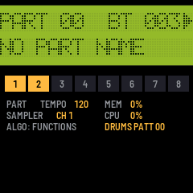
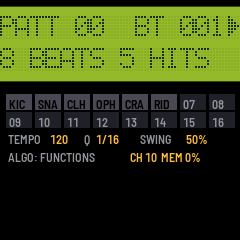
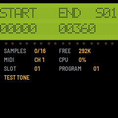

# SM-87

SM-87 turns the M-VAVE FM-1 into a 1987 studio: an **Alesis MMT-8** style part and song sequencer, playing an
**Akai S700/X7000** style sampler and an **Alesis HR-16** style drum machine. It records from the FM-1's keys or from
MIDI, plays samples sent over USB, and keeps its sequences, samples and settings in the FM-1's flash.

**SM-87 hasn't run on an FM-1 yet.** It works in the host simulator and in the browser emulator, which run the same
code. Try it in the [emulator](https://rogerkl.github.io/sm-87/emu/) first, and install it at your own risk.

---

## Contents

1. Install
2. What it does
3. Controls
4. Samples
5. When something goes wrong

---

## 1. Install

- **In the browser:** open the [installer](https://rogerkl.github.io/sm-87/install/) in Chrome or Edge, connect the
  FM-1 by USB and press Install. The browser asks once to allow MIDI, so allow it. Don't unplug the cable while it
  writes.
- **From a terminal:** download the release's `sm87-VERSION.fwsc` and run fm1-base's
  `python3 tools/fm1_install.py sm87-VERSION.fwsc`.
- **With samples and a drum kit of your own built in:** from [Axs7](https://rogerkl.github.io/Axs7/), which puts
  them into the package and installs it (INSTALL ON FM-1; see Axs7's
  [wiki](https://github.com/rogerkl/Axs7/wiki/SM-87)).

An install writes the firmware only: the FM-1 keeps its sequences, its settings and the samples sent to it. The
installer's last section puts M-VAVE's own firmware back.

To try it without an FM-1, open the [emulator](https://rogerkl.github.io/sm-87/emu/). It runs the same code in your
browser, with sound, and talks MIDI with SysEx both ways, so Axs7 can send it samples too. Its **Send .syx** button,
in the bar under the panel, sends a SysEx file straight in, with no MIDI cable: an MMT-8's or HR-16's memory dump, or a
sampler's dumps, as many as the file holds.

---

## 2. What it does

- **The sampler** plays samples the way an X7000 does. Every formula comes from the measurements in
  [04-playback.md](https://github.com/rogerkl/sm-87/blob/HEAD/documentation/akai-s700-x7000/04-playback.md), ported
  from [Axs7](https://github.com/rogerkl/Axs7)'s engine:
  - 6 voices, as the S700, or up to 16 if you raise it (VOICES, below).
  - 12-bit words, packed two to three bytes.
  - 4-point Hermite interpolation.
  - A 6-pole Butterworth lowpass whose cutoff follows velocity.
  - LEVEL and VEL>LEVEL as measured.
  - An exponential release whose time follows the note off's velocity.
  - Vibrato: a stepped sine, plus the mod wheel and aftertouch.
  - One shot, loop, alternating and drum trigger.
  - 32 programs of key ranges.
  - The S700's MIDI modes: OMNI OFF (its channel), OMNI ON (every channel), and MULTI PROGRAM, where channels 1-16
    play 16 programs from the one chosen (P1: programs 1-16), so each MMT-8 track can play its own program.
- **Sample memory** is 292 KB of flash (FREE on the strip): 6 full-length samples, as many as a stock S700 holds,
  or all 16 slots with shorter ones. Samples play in place from the flash. An empty slot holds the X7000's test tone.
- **Samples over MIDI.** The FM-1 answers as an X7000 with 16 slots: the sample dump in and out, SPRM/RSPRM and
  OVS/ROVS on the sampler's channel. So [Axs7](https://rogerkl.github.io/Axs7/) sends and fetches samples as it does
  with an X7000, and it can bring them from WAV files, `.qd` disk images or a real X7000.
- **The sequencer** works like the MMT-8:
  - 100 parts of 8 tracks and 100 songs of up to 255 steps, at 96 clocks a beat, in 64 KB of event memory.
  - Real-time recording replaces a track like tape. The first take on an empty part sets its length. Recording
    starts after a count-in, 4 beats unless set otherwise.
  - LOOP for parts only (as it starts), for parts and songs, or off; and the click: its value, when it sounds, and
    the count-in's length (LOOP/CLICK).
  - MIDI FILTER: what a take records besides notes (bend, controllers, programs, aftertouch), and from which
    channel.
  - Track mutes, saved per song step.
  - A part chosen while playing starts at the end of the current one. The LCD shows it queued (`PART 00>01 B004`),
    and under the strip the part playing and the next show large, with the beats to go until the change. An empty
    part has no end: played, its beats count on, and a part chosen meanwhile starts on the next beat. STOP clears a
    part queued.
  - Per-track MIDI channel, or UNCHANGED.
  - MIDI echo to the record track's channel.
  - MIDI clock and song position out, and MIDI clock in: the sequencer can follow another's clock and transport.
  - The MMT-8's memory dump over USB, both ways: an MMT-8's dump replaces the sequencer's memory, and ours goes out
    in the same format.
  - The MMT-8's functions: LENGTH (at the end or the top), ERASE and COPY with its 22 filters, MERGE, QUANTIZE (10
    grids, 4 modes), TRANSPOSE, MIDI CHANNEL, NAME, and EDIT, the event list editor; in a song ERASE, COPY,
    QUANTIZE (each track's clock offset, ±48), NAME and EDIT, its steps put in and taken out.
- **The drum machine** is a cut-down HR-16:
  - 16 pads on the white keys and on MIDI channel 10, each with its own sound, tuning (±24 semitones), level, pan
    (the HR-16's seven places) and note. The hats cut each other (a group); the crash and ride ring over themselves
    (two voices).
  - The sounds are the sampler's format (12 bits, at its rates) and play on its voices, without the filter: a kit
    built into the firmware (`resources/kit`), or any of the sampler's 16 slots.
  - 100 patterns of up to 682 beats, in the sequencer's memory. Recorded as they loop, each hit quantized (1/4 ..
    1/64, or off) and swung (the HR-16's swing, up to 58-69%) as it goes in, the HR-16's way. Its STEP EDIT,
    OFFSET and FILL too.
  - A pattern can keep its own sounds, as the HR-16 stores VOICE, TUNE and MIX with a pattern; one without them
    plays the pads' global set-up.
  - The HR-16's memory dump over USB, both ways: an HR-16's dump replaces the drum patterns, and ours goes out in the
    same format, also when an HR-16's request for one comes.
  - With the MMT-8: one clock and tempo. A song step chooses the drum pattern that plays with it (or none). Playing
    a part, the drums loop their own pattern beside it; with PROGRAM CHANGE on, a program change in the part
    chooses it. On their own page they play alone.
- **The screen** is a 2 × 16 character LCD, drawn dot by dot, with a status strip under it and, between them, a
  light for each MIDI channel.

---

## 3. Controls

| | |
|---|---|
| Keys | Play the sampler on its channel (and out over USB); OCT- / OCT+ shift them |
| SEQ | The sequencer's page; again (stopped): PART ↔ SONG |
| PLAY | Play from the top / stop; SEL + PLAY continues from the beat (where it stopped, or where SELECT put it) |
| REC | Arm recording on the part's lowest empty track (or the one chosen with REC + its key); again: disarm; while a take runs: punch out (the part plays on) |
| SEL + first 8 white keys | Track mutes (on the SEQ page; in a song: the step's mutes); the 9th: the drums on or muted |
| REC + first 8 white keys | The record track; the armed track's key again: none (until REC + a key chooses one) |
| PRESET | The part or song (SEQ page; while a part plays, the next, queued for its end), else the sampler's program |
| K1 / K2 (SEQ) | Tempo / the record track's channel (UNCHANGED, 1-16) |
| K4 (SEQ) | The drum pattern that plays with the parts; in a song (stopped): the step's drum pattern, or none (the step's row shows it: `P05 12345678 D07`, `D--` none) |
| ALGO (SEQ) | The MMT-8's functions, below; SEQ goes back to the part or song |
| SELECT (SEQ) | The place, as the MMT-8's fast-forward and rewind (below): a part by beats (SEL: by four); a song by steps (SEL: by beats) |
| SELECT / K3 (SONG, stopped) | The step, shown and edited, and where SEL + PLAY goes on from / its part (at the END: appends the last part; past 99: the song ends there) |
| ARP | The drum machine's page (below); from one of its functions: back to the pattern |
| EDIT | The sampler's pages round: POINTS (START, END), LOOP (LOOP, MODE), TUNE (ROOT, FINE, RATE), KEYS (LO, HI, TRANSPOSE, CONSTANT), CLEAR (REC empties the slot) |
| ENV | OUT (FILTER, RELEASE, LEVEL), then the velocity amounts |
| LFO | SPEED, DEPTH, DELAY, PRESSURE |
| SELECT / K1-K4 (sampler pages) | The slot / the page's values. The strip under the LCD shows the slot, its sample and the program |
| HOME | The sampler's overview |
| GLO | MIDI: K1 the sampler's channel, K2 its mode (OMNI OFF, ON, MULTI), K3 the pitch bend's range, K4 the drums' channel. GLO again: the MIX, and again the VOICES (below) |
| SAVE | Lit when something isn't saved: settings, the sample parameters, the sequencer (stopped) |

**The channel lights**, the row of 16 between the LCD and the strip, flash as a message on their MIDI channel comes
in or is played: from MIDI in, the keys, the sequencer, the drums, or MIDI ECHO. They go in pairs over the track
buttons, channels 1 and 2 over track 1 through 15 and 16 over track 8, so a track's channel is easy to find (channel 5
is the left light over track 3). They're on every page, which helps to see what channel a keyboard sends on.

**Under the strip on the SEQ page**, the part playing and the one after it, large, with their names (the drum page
has the same for its patterns):

- **PLAYING** (stopped: **PART**) and **NEXT**. Turning PRESET while a part plays queues the next part; NEXT shows it
  at once, lit, with the beats to go (`IN 3 BEATS`), and the bar along the foot fills up to the change. Turning
  back to the part playing clears it. With none queued, NEXT is the same part, dim: it `PLAYS AGAIN` (with LOOP
  OFF, `THE PART ENDS`). An empty part playing has no end, so NEXT says a part chosen `STARTS NEXT BEAT`, and
  counts down to that beat.
- **In a song:** the step and its part, then the next step and its part (`THE SONG ENDS` after the last, unless
  LOOP is ALL).
- **LOOP** beside the number playing: LOOP/CLICK's setting, `PARTS`, `ALL` or `OFF`. It's lit when what plays goes
  round (a part with `PARTS` or `ALL`; in a song, `ALL`), and dim when it doesn't (`OFF`; `PARTS` in a song).

**SELECT moves the place**, as the MMT-8's fast-forward, rewind and auto-locate:
- **In a part,** each detent is a beat, or with SEL held four. The LCD's `BT` shows where, and the bar along the foot
  of the screen too. At the part's ends it goes round while LOOP lets parts go round (`PARTS`, `ALL`), and stops on
  the first or last beat with LOOP `OFF`.
- **Stopped,** SEL + PLAY plays from there; PLAY still plays from the top.
- **Playing,** the part goes on at once from the start of the beat reached. Notes sounding stop, as on the MMT-8.
- **With a part queued** (PRESET while playing), going on past the end goes into that part from its top, as at the
  end, and stops there: the rest of the turn is dropped, and SELECT doesn't move the place again until it has rested
  for a moment. Back past the start still goes round.
- **The drums** beside the part move as far, so they stay with it.
- **In a song,** SELECT goes by steps, to a step's start, and SEL + SELECT by beats across the steps. Stopped, the
  step SELECT shows is the one K3, K4 and the track keys edit, and SEL + PLAY plays from its start. When a song
  stops, the step shown is where it stopped. At the song's ends it goes round with LOOP `ALL`.
- **Not while recording,** a count-in included (`RECORDING`, `STOP FIRST`), and not while following MIDI clock, whose
  song position sets the place.
- **MIDI clock out:** a jump while playing sends a stop, the song position and a continue, so whatever follows the
  clock goes there too.

### MIDI modes (GLO)

The S700's MIDI modes, from its manual (33-37), set with K2 on the GLO page:
- **OMNI OFF** (as before): the sampler hears its channel (K1) and plays the program shown (PRESET).
- **OMNI ON:** every channel plays the program shown.
- **MULTI** (the S700's MULTI PROGRAM / POLYPHONIC): channel 1 plays the program shown, and each channel after it
  the next program, as on the S700. With P1 shown, channel 1 plays program 1, channel 2 program 2, up to 16; with
  P2 shown, channels 1-16 play programs 2-17. (That's what the S700's manual means by "P1-16 (17-32)": P17 shown
  gives programs 17-32.) Past P32 they go round to P1: with P20 shown, channel 14 plays P1. That part is a guess.
  The voices go to whichever channel needs one. A program change on the sampler's own channel chooses the program
  shown, which moves all 16. One on another channel is ignored. Pitch bend, the mod wheel and aftertouch are each
  channel's own.

In MULTI the keys play channel 1, the program shown. A track you record from the keys plays channel 1 when its
channel is UNCHANGED, so it plays whatever program is shown then. To give a track a program of its own, set its
channel (K2 on the SEQ page, or MIDI CHANNEL): with P1 shown, channel n plays program n.

Channel 10 is the drums' too. In MULTI it also plays a program: program 10 with P1 shown.

OVS (Akai's overall settings) carries the mode both ways.

### The mix (GLO, then GLO again)

`LEV PAN SLOT DRM` / `99  L20  01  99`:
- K1 sets a sampler slot's level (0-99, a fader's curve), and K2 its pan (L50 .. C .. R50).
- K3 or SELECT chooses the slot.
- K4 sets the drums' bus level; the pads are panned on their own (PAD SOUND).

The S700 is mono, so by default every slot is at full level in the middle, and sounds as before. The level and pan
belong to the slot, like a mixer's channel strip, so a sample sent to the slot keeps them. They act at once, on notes
already sounding too, and are kept in the settings (SAVE).

### Voices (GLO a third time)

`VOICES (S700)  6` / `PLAYING        2`: K1 sets the number of voices the sampler may play at once, from 6 (as the
S700, shown `(S700)`) up to 16. A seventh note on six voices takes over a voice that is fading, or else the oldest,
as on the S700; with more voices that happens later. PLAYING counts the voices sounding now. A key whose note is in
several samples (keygroups that overlap) takes a voice for each.

Every voice costs the audio interrupt time: the strip under the LCD shows CPU while notes play. The FM-1's limit isn't
measured yet; if the sound breaks up with many notes held, lower it. Lowered while more play, the voices over the
new number fade as if their notes were let go. The drums have their own 8 voices and aren't counted. It's kept in
the settings (SAVE).

### The drum machine (ARP)

The LCD shows the pattern and its beat (`PATT 05  BT 003`, `PATT 05>07` with 07 queued), then its length and hits,
or while recording the quantize and swing. The strip shows the 16 pads, lit as they sound. Under it, as on the SEQ
page, the pattern playing and the next show large, with their lengths and hits: a pattern queued with PRESET lit,
with the beats to go (`IN 3 BEATS`); in a song, the step's pattern and the next step's (`NO DRUMS` for a step
without). The drums muted beside a part show `MUTED`.

| | |
|---|---|
| White keys | The 16 pads, by velocity (the black keys do nothing here) |
| PLAY | The drums alone, from the top / stop; SEL + PLAY: on from the beat |
| PRESET | The pattern; while playing, queued for the end of the one playing |
| K1 / K2 / K3 | Tempo / quantize (1/4, 1/8, 1/12, 1/16, 1/24, 1/32, 1/48, 1/64, off; another: no swing again) / swing, the HR-16's clocks (below) |
| REC | Recording on or off: the hits played (pads, or MIDI in on the drums' channel) go into the pattern as it loops |
| SEL + a pad, recording | Erases that pad's hits as they come by, while held (the HR-16's ERASE + a pad) |
| OCT+ held | FILL: a pad held repeats at the quantize rate (off: 1/32), at the velocity it was hit at, while the drums play; recorded when recording. (The pads have no octave: OCT- and OCT+ don't change it here) |
| ALGO | The functions below; ARP goes back to the pattern |

A new pattern is 8 beats long, as on the HR-16. A hit is placed on the nearest step of the quantize grid. It's heard
as it's played, and played back from the next time round. Recording counts with the click (the SEQ page's
LOOP/CLICK: its record click, at its value). It records when the drums play alone, or beside a part; it doesn't
record in a song.

**Swing** is the HR-16's: K3 sets how many clocks (96ths of a beat) every second step of the quantize grid comes
late, so a hit recorded or step-edited lands there; hits already in the pattern stay where they are. How far it goes
depends on the quantize, as in the HR-16's table, and choosing another quantize sets it back to none. The strip shows
it as the HR-16 does beside its number, as a percentage: where the second step falls in the pair, 50.0% none.

| Quantize | 1/4 | 1/8 | 1/12 | 1/16 | 1/24 | 1/32 | 1/48 | 1/64 | off |
|---|---|---|---|---|---|---|---|---|---|
| Swing, clocks | 0 | 0-16 | 0-12 | 0-8 | 0-6 | 0-4 | 0-2 | 0-1 | 0 |
| At most | 50% | 66.7% | 68.8% | 66.7% | 68.8% | 66.7% | 62.5% | 58.3% | 50% |

The HR-16's 1/6 (0-24, up to 68.8%) isn't one of SM-87's quantize values. A swing saved by an earlier SM-87, as a
percentage, loads as the clocks nearest it.

| Function | K1 | K2 | K3 | K4 | REC |
|---|---|---|---|---|---|
| STEP EDIT | The hit's place, a clock (SEL: a step) | Its velocity | Its pad | The grid | Erases the hit shown |
| LENGTH | Beats, 1-682 (SEL: tens) | | | | Sets the pattern's length (stopped): hits past the end go |
| ERASE | A pad, or all (a pad's key chooses it) | | | | Erases that pad's hits, or the whole pattern |
| COPY | The pattern to | The pad from, or ALL (a pad's key chooses it) | The pad to (the next pad key) | | ALL: appends the pattern to the other (an empty one gets a copy; itself: twice as long). A pad: merges its hits onto the pad to (below) |
| OFFSET | Clocks, -99..99 (384ths; SEL: tens) | A pad, or all (a pad's key chooses it) | | | Moves the hits that much later (+) or earlier; past the end round to the start, and back. Again: as much again |
| PAD SOUND | The sound: the kit's, then SLOT01-16 | Tuning, ±24 | Level | Pan, <3 .. 3> | Keeps the pads' sounds with the pattern; SEL + REC: lets them go (the global set-up again) |
| PAD MIDI | Its note | Its group (pads that cut each other) | Voices, 1 or 2 | The drums' channel | The pad as the kit sets it (sound and MIDI); SEL + REC: all of them |
| PROGRAM CHANGE | `PATT SELECT` ON or OFF: a program change on the drums' channel chooses the pattern (below) | | | | |
| MIDI DUMP | | | | | Sends the drum patterns as an HR-16's SysEx dump, over USB (below) |

On a pad's function, a pad's key chooses it (and plays it); so does SELECT.

**COPY a pad's hits**, as on the HR-16: on COPY, a pad's key chooses the pad to copy from (`KICK > ?`), and the next
pad key the pad to copy to (`KICK > TOM1`); K2 and K3 choose them too. K1 is the pattern to copy to, this one or
another. REC merges the hits onto that pad: the pattern keeps its length (hits past its end aren't copied), and a hit
the pad already has at the same clock takes the copied one's velocity. The pad to keeps its own sound. Until a pad to
is chosen REC does nothing (`A PAD TO COPY TO`). K2 turned past the last pad goes back to ALL, the whole pattern.

**A pattern's own sounds** are the HR-16's VOICE, TUNE and MIX stored with a pattern: each pad's sound, tuning,
level and pan. PAD SOUND's top line says whose the pads have:
- **`01 KICK   GLOBAL`**: the pattern has none of its own and plays the global set-up. An edit changes the set-up,
  for every pattern without its own, and is kept with the settings (as before patterns had sounds).
- **`01 KICK   PAT 05`**: pattern 05's own. An edit shows `PAT 05*` and lasts until REC stores it, or until another
  pattern is chosen or comes in, which loses it, as on the HR-16.
- **REC keeps the pads' sounds with the pattern**, all 16 pads at once. **SEL + REC lets them go**: the pattern plays
  the global set-up again.
- **The pads change with the pattern** as it starts: one queued, or a song step's. When stopped, they have the
  chosen pattern's sounds.
- **COPY** to an empty pattern copies its sounds too; appending to a pattern with hits keeps that pattern's. ERASE
  keeps them.
- **A pad's MIDI** (note, group, voices) is the same in every pattern.
- Each pattern's sounds take 64 bytes of the sequencer's memory. They keep a kit sound by its number and a slot as
  the slot, so a kit grown later leaves them as they were. A memory saved before this loads with none.

**Program change** (the HR-16's MIDI PROGRAM CHANGE) lets a part choose its drums. It's off until PROGRAM CHANGE
says `PATT SELECT  ON`, as on the HR-16, and is kept in the settings (SAVE).
- **Program 0-99 chooses pattern 00-99**, and 100-127 patterns 00-27, as on the HR-16. It comes on the drums'
  channel (10), from a track of a part playing or from MIDI in.
- **It works as PRESET does:** stopped, the pattern changes at once; playing, it's queued for the end of the one
  playing (the HR-16's NEXT). One that comes just as the drums start over takes over at once: a program change on a
  part's first clock changes the drums on that downbeat, when the part and the pattern start together (their
  lengths fit, or PLAY started both).
- **Ignored while the drums record** (the HR-16 doesn't change pattern while recording) and **while a song plays**,
  whose steps choose the drums.
- **To give a part its drums:** put a program change on channel 10 at its first beat. Play one into a take in the
  count-in's last sixteenth (it lands on beat 1), or add it with EDIT: a track's key, SELECT to END OF TRACK, K2 to
  `ADD PROG` (K1 leaves it at `001.00`), REC; then on the event K2 sets the program and K4 its channel, 10. A track
  whose channel is set plays everything on that channel, so use a track left UNCHANGED, or one set to 10.
- In OMNI ON the sampler hears every channel, so a program change on 10 changes its program too, as on an S700.

**STEP EDIT** is the HR-16's step mode. `STEP 001 + 24/96` is beat 1, clock 24 of 96, and below it is the hit there
(`CLHAT  V 40 2/2`: the closed hat at velocity 40, the second of two hits), or EMPTY.
- **SELECT** goes from place to place, forwards or back. It stops at each step of the quantize grid (swung, as
  recording places hits) and at every hit, on the grid or off it. Where there are several hits, it shows one at a
  time. With SEL held it goes by beats. At the pattern's ends it goes round.
- **Each place reached sounds** its hit. The strip and the white keys light the pads with a hit there.
- **A pad played adds a hit** at the place, from a white key or MIDI in. A pad that already has a hit there gets the
  new velocity, as on the HR-16.
- **K1 moves the hit shown**, a clock at a time, or a step with SEL held. It stops before another hit of the same
  pad. K2 changes the hit's velocity, K3 its pad (skipping pads with a hit there), and K4 the grid.
- **REC erases the hit shown.**
- **PLAY leaves STEP EDIT** and plays from the top.

**The HR-16's memory dump**, as its service manual has it (`documentation/hr16-sysex.md`):
- **In:** send an HR-16's dump to the FM-1 over USB at any time (on an HR-16, with SYSEX ENABLE on: TAPE held, the
  left arrow once, RECORD). The LCD counts the bytes, with the share of the whole once the dump's header has come
  (`HR-16 DUMP IN`, `BYTES  2048  12%`). The dump replaces all 100 drum patterns, as it would on an HR-16; the
  MMT-8's parts and songs stay. SAVE keeps it. Then the LCD says how many patterns came, and above them
  `HR-16 DUMP IN`, or why not all did, as for the MMT-8's dump below.
- **What comes across:** each pattern's hits, its length, and its VOICE, TUNE and MIX as the pattern's own sounds;
  the swing and quantize, as the recording's (its 1/6 becomes 1/8, its swing at most 1/8's).
- **What doesn't:**
  - Its songs: SM-87's drums follow the MMT-8's songs. When the dump has any, the LCD says `SONGS NOT TAKEN`.
  - Its MIDI settings and tempo. The drums keep SM-87's notes and channel, so the MMT-8's tracks still play them.
    Those bytes are kept, though, and go back out in ours. Its PROGRAM CHANGE switch is the exception: it comes
    across, and ours goes out in its place.
- **Its drums on the pads**, by role:

  | Pads 1-6 | Pads 7-8 | Pads 9-12 | Pads 13-16 |
  |---|---|---|---|
  | KICK, SNARE, CLS HAT, OPN HAT, CRASH, RIDE | MID HAT, CLAPS | TOM 1-4 | PERC 1-4 |

- **Its sounds** become the kit's sound of the same kind: kicks the KICK; snares, the rimshot, sidestick and brush
  the SNARE; the closed and foot hats CLHAT; the half-open and open hats OPHAT; the rides and the crash the CYMBL.
  The kit has no toms, claps or percussion, so a pad with one of those keeps the sound it has in the global set-up.
  To hear them, give pads 7-16 sounds (sampler slots, say) on PAD SOUND before the dump comes in.
- **Dynamics and tuning:** the HR-16's 8 dynamics become velocities 15, 31 .. 127, and go back the same. Its 32
  tuning steps span an octave and a half, so each becomes the nearest semitone (-9 to +8). Going out, a tuning
  beyond that range goes as the HR-16's highest or lowest step.
- **Out:** MIDI DUMP (the drum page's last function), REC. An HR-16's request for a dump (`F0 00 00 0E 01 07 F7`)
  sends it too, unless the FM-1 is playing, as an HR-16 does. Its MIDI test is answered.
  - Each pad's sound goes as one of the HR-16's 49 of its kind: on each drum, the one most patterns of the last HR-16
    dump had there, if it is that kind. A pad playing a sampler slot, or nothing, goes as that drum's sound in the
    last HR-16 dump.
  - As with the MMT-8, the header comes from the last HR-16 dump taken in, so **send the FM-1 one of your HR-16's
    dumps first** (MIDI DUMP's strip says `HEADER: AN HR-16'S` then). Without one, the header is made up: the notes
    the pads', the channel the drums', the tempo the sequencer's, and zeros where the manual says not to alter. An
    HR-16 may not take that.
  - The FM-1 takes its own dump back the same, byte for byte. A real HR-16 taking one is untested, and so is the
    sound list's numbering (the manual gives none; `documentation/hr16-sysex.md` says where it's from).

**With the sequencer**, the two share one clock, one tempo and one transport. Which pattern plays depends on how
PLAY was started:

- **From the SEQ page, in PART mode:** the sequencer's PLAY plays the part, and the drums loop their pattern beside
  it, each on its own length. K4 chooses the drum pattern, queued while playing. SEL + the 9th white key mutes the
  drums.
- **From the SEQ page, in SONG mode:** each step's drum pattern (K4 on the step, or in the song's EDIT) starts with
  the step, and is cut at the step's end. A step without one is quiet. A new step takes the drums of the step
  before. A step lasts as long as its part: a part without a length (an empty one) is passed over, as the MMT-8
  does, and its drums with it.
- **From the drum page:** PLAY plays the drums alone, as pressing PLAY on an HR-16 would.

The drums' hits go out over USB on the drums' channel (10 unless set), and notes coming in on that channel play the
pads. So an MMT-8 track on channel 10 plays them too.

### Recording a part

1. SEQ, and PRESET to the part. The LCD's top left says PART (SEQ again switches to SONG, which plays parts but
   doesn't record).
2. REC: it lights, and the LCD shows `REC TRK 1`, the part's lowest empty track. REC + a track key chooses
   another; it stays chosen until you change part. REC + the armed track's key again leaves none chosen, as on the
   MMT-8: REC then says `NO TRACK CHOSEN` until REC + a key chooses one, or you change part.
3. PLAY: four clicks of count-in (`COUNT IN 4` .. `1`), then it records from beat 1. Notes in the count-in aren't
   recorded, except one played in its last sixteenth, which lands on beat 1. LOOP/CLICK sets the count-in's length;
   with none, recording starts at once.
4. REC punches out: the take ends and the part plays on, as on the MMT-8. On an empty part this sets its length, to
   the nearest beat, and the part goes round at it (until then PRESET waits: the LCD says `FIRST TAKE`,
   `REC SETS LENGTH`). PLAY stops instead, setting the length the same way. Later takes end at the part's end: the
   part plays on, or with LOOP OFF it stops there. The LCD says `RECORDED TRACK 1`, or `NOTHING RECORDED` when
   nothing was played after the count-in (then it stops).
5. PLAY plays it back. Another REC arms the next empty track, so takes don't record over each other unless you
   choose a recorded track yourself (like tape, that replaces it).
6. SAVE (lit while something isn't saved) keeps it in the flash. Without it, the part is gone after a power cycle
   (or a reload of the emulator page).

### The MMT-8's functions (ALGO on the SEQ page)

As on the MMT-8, where you hold a function's button: the first eight white keys are the track buttons, K1-K4 set the
function's values, and **REC does it** (RECORD). Nothing changes before REC. The functions that change the part's
events wait until the sequencer stops ("STOP FIRST"). A function is the part's shown: when a part queued takes over,
its page starts again from the new part's values (a name half typed is let go). The tracks: a function starts with
all eight lit; a track key chooses only its own, then the keys add and take away. COPY and MERGE take a track from
(lit) and one to (flashing; red on the screen). The strip under the LCD shows the tracks and the function.

| Function | K1 | K2 | REC |
|---|---|---|---|
| LENGTH | Beats, 1-682 (SEL: tens) | At the end / at the top | Sets the part's length: events past a new end go, a note held over it is cut; at the top, the beats are added or taken off at the start |
| ERASE | What: all, notes, bend, controllers, programs, aftertouch, or channel 1-16 | | Erases it from the tracks lit; all of everything: EMPTY PART. In a song: the song |
| COPY | The part (song) to | What, as ERASE | All tracks: the part goes after the other's end (an empty one gets a copy; itself: twice as long). One track (and one to): over that track, cut to the other part's length. In a song: after the other song's steps |
| MERGE | | | The track lit onto the flashing one, both channels baked in, the merged track UNCHANGED |
| QUANTIZE | 1/2 ... 1/64 | Note start / start & end / note end / keep duration | The notes of the tracks lit |
| QUANTIZE (SONG) | The track's offset, ±48 clocks (384ths), at once | | |
| TRANSPOSE | Semitones, ±99 (SEL: octaves) | | The tracks lit; out of range folds back by octaves |
| MIDI CHANNEL | The track's channel, UNCHANGED or 1-16, at once | | |
| NAME | The cursor | The character | Stores the 14-character name (a part once used) |
| EDIT | The event's place (SEL: by beats) | Key, controller, program, bend (SEL: the channel) | Adds a C3 note where the event shown is; SEL + REC erases the event |
| CLOCK | In: INTERNAL or MIDI | Out: ON or OFF | (at once; SAVE keeps it) |
| LOOP/CLICK | LOOP PARTS, ALL or OFF | The count-in, 0-99 beats | (at once; SAVE keeps it) K3 the click's value, K4 when it clicks (below) |
| MIDI FILTER | Bend recorded or not | Controllers | (at once; SAVE keeps it) K3 programs, K4 aftertouch, SELECT the channel (below) |
| MIDI DUMP | | | Sends the whole memory as an MMT-8's SysEx dump, over USB |

**EDIT** shows one track's events (the track key chooses which), as the MMT-8: `1 001.05 E3  100` is track 1, beat
1, clock 5, E3 at velocity 100, and `DUR 001.00 CH01` its duration (a beat) and channel (in brackets when the track
plays on a channel of its own). SELECT goes from event to event; K3 is the velocity (a controller's value, the bend
fine), K4 the duration (SEL: by beats; not a note: the channel). Past the last is END OF TRACK: K1 is where REC adds,
K2 what (a note, a program change, a controller, bend, aftertouch). In a **song**, EDIT shows its steps: SELECT the
step, K1 its part, the track keys its tracks, REC puts a step in before it (at the end: the part K1 chose), SEL + REC
takes it out; the steps change only while stopped (`STOP FIRST`). While playing, EDIT follows: the last event played on the track (in a song, the step playing); stopped,
it stays on it, ready to edit.

**QUANTIZE in a song** sets each track's clock offset, as the MMT-8's: the track key chooses the track (track 1
first), K1 moves it up to 48 clocks (half a beat) late (+) or early (-), to make up for a slow attack or MIDI delay.
The offsets are every song's, kept with the sequencer's memory, and take effect from the next PLAY. An early track
reads into the next step's part; at the song's start its first clocks play at once (the MMT-8's first beat can't be
advanced), and a late track's last clocks are cut when the song ends.

**LOOP/CLICK** is the MMT-8's LOOP button and CLICK pages: `LOOP PARTS  IN 4` / `CLICK 1/4    REC`.
- **K1, LOOP:** the MMT-8's LOOP is one switch for parts and songs; here it has three settings.
  - `LOOP PARTS`, as it starts: a part goes round again at its end, and a song stops after its last step.
  - `LOOP ALL`: a song starts again from its first step too.
  - `LOOP OFF`: a part plays once and stops at its top. A part queued with PRESET still follows.

  A take on a part with a length ends at the part's end; with LOOP OFF the sequencer stops there too.
- **K2, the count-in (`IN`):** the beats it counts before a take, 0-99 (the MMT-8's default, 4). With 0 recording
  starts on PLAY. The count-in always clicks.
- **K3, the click's value:** 1/2, 1/4 (a beat), 1/6, 1/8, 1/12, 1/16, 1/24, 1/32, 1/48 or 1/64. The click on the
  first beat of each four-beat bar is higher.
- **K4, when it clicks:** `REC` while a take records (as the MMT-8 starts), `PLAY` while playing without
  recording, `BOTH`, or `OFF`. The drums recording on their own click with the record click too.

**MIDI FILTER** is the MMT-8's: what a take records besides notes. `FILTER    CH ALL` / `BEND CC PROG ---`.
- **K1-K4:** pitch bend, controllers, program changes and aftertouch, each recorded (turned right, its name shown)
  or not (left, dashes). As on the MMT-8, all are on except aftertouch. Poly aftertouch is never recorded, and nor
  is SysEx.
- **SELECT:** the channel a take records from, `CH ALL` or 1-16. Notes on other channels aren't recorded either.
- **Recording only:** on the MMT-8 the filter also kept what it left out from going on through MIDI ECHO. Here it
  all still plays the sampler and goes out, so an external keyboard's aftertouch still reaches the sampler's
  vibrato.

**MIDI clock in** (CLOCK, K1 to MIDI): the sequencer follows MIDI clock from USB or the TRS jack. F8 moves it on
(each plays 4 of its 96 clocks a beat, spaced by the last beat's clocks); FA starts from the top at the next clock,
FC stops, F2 (song position) sets the place while stopped and FB goes on from there. PLAY still plays, but waits
for clocks. The strip shows the tempo the clocks come at (`MIDI 120`). MIDI clock out (K2) goes on as it was, so
the FM-1 passes the clock on. Clocks are timed in rendered frames, to a block (2.9 ms); the notes land on them.

**The MMT-8's memory dump**, as its SysEx document has it (`documentation/manuals.md` lists the manuals):
- **In:** send a dump to the FM-1 over USB at any time (from a SysEx librarian; an MMT-8 sends one with TAPE held,
  PAGE DOWN, RECORD, through a computer's MIDI interface). MIDI DUMP's strip says so: `IN: ANY TIME`. The LCD
  counts the bytes, with the share of the whole once the dump's header has come (`MMT-8 DUMP IN`,
  `BYTES 41256  86%`). The dump replaces the sequencer's memory (parts, songs, names, channels; the song offsets and
  the drum patterns stay ours) and SAVE keeps it. Its SysEx events aren't kept.
- **What came:** the LCD says how many parts and songs it took (`93 PTS 41 SONGS`), and above them:
  - `MMT-8 DUMP IN`: all of it.
  - `DUMP CUT SHORT`: bytes were lost on the way, fewer came than the dump's header says it has. What came before
    the loss is taken. Send it again. A long dump sent as one message through a virtual MIDI cable can lose bytes; a
    librarian that sends it in pieces with a pause between them, as an MMT-8 sends it at MIDI's speed, is safer. In
    the emulator, its Send .syx button sends a file with no cable on the way.
  - `DUMP DAMAGED`: all of it came, but a part or song in it can't be read (bytes changed on the way: a track's
    events going back in time, say). What can't be read isn't taken; the rest is.
  - `MEMORY FULL`: the sequencer's 64 KB holds a little less than an MMT-8's. A note sharing a clock takes 7 bytes
    here and 5 there, so a full memory of chords may not fit. The LCD says from which part on it didn't
    (`FROM PART 96`), or how many parts and songs it took when only songs didn't fit.
- **Out:** MIDI DUMP (the last function), REC: the whole memory goes out over USB, as an MMT-8 sends it. The FM-1
  takes it back the same, byte for byte.
- **To a real MMT-8:** two things the document leaves out come from
  [polluxsynth's mmt8utils](https://github.com/polluxsynth/mmt8utils), a librarian that writes dumps MMT-8s take:
  the BCD beats are the beats + 1, and a dump made from nothing confuses an MMT-8, because the header's other
  bytes have to come from one of its own dumps. So the FM-1 keeps the header of the last dump it took in and sends
  it back in its own: **send the FM-1 one of your MMT-8's dumps first** (MIDI DUMP's strip says `HEADER: AN MMT-8'S`
  then). mmt8utils' own librarian reads the FM-1's dumps right (each part's name, beats and length, each song's name,
  tempo and length); a real MMT-8 taking one is untested.

**A slot into a program:** PRESET to the program, EDIT to the KEYS page, SELECT to the slot. LO and HI show `--`
while the slot isn't in the program (the strip says OUT). One detent of K1 (LO) or K2 (HI) puts it in with the whole
keyboard, C0-D#6; then K1 raises the low key and K2 lowers the high one. Turning LO past HI (or HI under LO) takes the
slot out again, and one detent back puts it in on the same keys. SAVE keeps it.

**Clearing a slot:** EDIT to the CLEAR page (the last of the round), SELECT to the slot, then REC.
- The page shows what the slot holds: `BUILT-IN SAMPLE`, `SAMPLE 48K` (the flash it takes), or `TEST TONE`, where
  there's nothing to clear. The strip under the LCD gives the sample's name.
- REC takes the sample out, whether it was built in or received over MIDI. The slot is then as an X7000's empty one:
  the test tone, its parameters as the sampler starts them, in no program. A received sample's flash is free for the
  next.
- SAVE keeps it, and so does a sample received after it (that saves the slots, see below). Until then, a power cycle
  brings the sample back. A built-in sample stays cleared until a firmware with other built-in samples is installed,
  which fills the empty slots with its own.
- The drum kit's sounds aren't in the slots, so CLEAR doesn't touch them. A pad set to play a slot plays the test tone
  once that slot is cleared.

Samples received over MIDI are written to the flash at once. The slots (the sample each one plays, and every slot's
parameters, panel edits too) are saved 3 s after the transfer goes quiet. If the power goes before that, the slots
come back as they were last saved. A slot cleared or replaced since then comes back empty (the test tone) when the new
sample took its flash, never playing the new sample's data: a dump saves the slots first before writing over a sample
they still name.

---

## 4. Samples

SM-87's sampler answers over USB as an X7000 with 16 slots does, so [Axs7](https://rogerkl.github.io/Axs7/) sends
and fetches samples as it does with one: from WAV files, the sampler's `.qd` disk images, or a real S700/X7000.
Choose the FM-1's port in Axs7's MIDI view and set SLOTS to 16 (Axs7's wiki,
[Connecting the sampler](https://github.com/rogerkl/Axs7/wiki/Connecting-the-sampler)).

While a sample comes in or goes out, the LCD shows its slot and the words so far (`DUMP IN  SLOT 07`,
`WORDS 12000  37%`), then `RECEIVED` or `SENT`. Its parameters (`PARAMETERS IN`, `PARAMETERS SENT`) and the MIDI
settings Axs7 reads or changes (`MIDI SETTINGS`) show for a moment as they come and go. In the browser emulator a
dump arrives all at once, as the browser passes a SysEx on only when it is whole, so only what came of it shows.

A dump that stops before its sample's end lost bytes on the way: a long SysEx through a virtual MIDI cable can. The
LCD then says `DUMP CUT SHORT` with the words that came of those the sample has (`S10 21000/28752`), and again when
its parameters come after it. SM-87 keeps what came, so the sample stops early and its loop turns at the last word
that came, though START, END and LOOP show the sample's own. Send it again. (A sender announces up to 200 words more
than it sends, so a dump may end a little before its header's count; it always comes up to its loop end, the
sample's end.)

Samples sent go into the sample pool, about 292 KB, and the strip shows how much is FREE. Samples and a drum kit can
also be built into the firmware, about 370 KB more: from Axs7 (its wiki's
[SM-87](https://github.com/rogerkl/Axs7/wiki/SM-87) page), or with `tools/mkrom.py` (the
[README](https://github.com/rogerkl/sm-87#samples-built-in)).

---

## 5. When something goes wrong

If an install goes wrong:
- Felucca's boot-loop guard: hold OCT- + OCT+ for 5 s.
- m-bootloader.
- MvaveFM1Unbricker.

If a dump sent to SM-87 ends with `DUMP CUT SHORT`, bytes were lost on the way to it: send it again, in pieces if
the sender can (the MMT-8's memory dump, under Controls, says more).

SM-87 is new and untried on the FM-1 itself. Report what happens at
[github.com/rogerkl/sm-87/issues](https://github.com/rogerkl/sm-87/issues).
